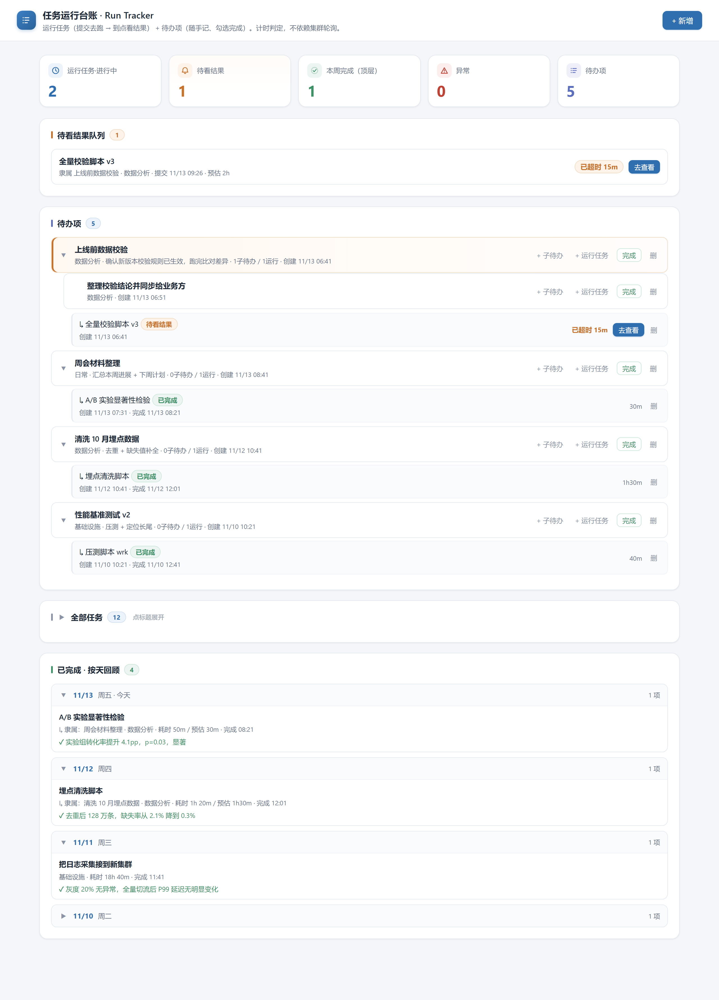

# RunLedger

A local task ledger for work that takes time: record a task, mark it submitted,
estimate the wait, check the result, and keep the conclusion.

[中文说明](README.md) · [MIT license](LICENSE)



RunLedger uses only the Python standard library. There is no database, build
step, external service, or telemetry. It stores records in a local JSON file.

## Start

Requires Python 3.9 or later.

```bash
git clone https://github.com/hustZhangYu/runledger.git
cd runledger
python app.py
```

On Windows, use `py -3 app.py` if `python` is unavailable.
Open http://127.0.0.1:7860. A missing `runs.json` starts an empty ledger.
To try the fictional sample, copy `runs.example.json` to `runs.json` first;
back up any existing ledger before replacing it.

## Workflow

- Create regular to-dos or timed runs, optionally grouped under a parent to-do.
- Submit the real job yourself, then mark the record submitted in RunLedger.
- After the estimate expires, the record appears in the results-to-check queue.
- Record the conclusion, mark it complete, and review completed work by date.
- Rerun or reopen a task when needed. Deleting a parent also deletes its descendants.

Durations include `30m`, `2h`, `1h30m`, and plain minutes such as `90`.
RunLedger never executes the commands recorded in a task. It uses estimated
time, rather than polling the real job. The page refreshes every 30 seconds;
there are no built-in desktop notifications.

## Data and scripts

- Back up `runs.json` by copying it; personal data is excluded from Git.
- `python reminder.py` prints overdue runs without requiring the web server.
- `log_run.py` accepts a JSON task through an argument or stdin. Stop the web
  server before using it: independent writer processes do not share a lock.
- `RT_HOST` and `RT_PORT` configure the server. The default is `127.0.0.1:7860`.

This is a personal local tool with no authentication. Keep it on localhost.
Writes within one server are serialized and saved using an atomic replacement;
do not run multiple writers against the same file. Invalid JSON or an invalid
top-level data structure produces an error and preserves the original file.

## Tests

```bash
python tests/smoke_test.py
python tests/api_test.py
```

Tests use temporary data and the HTTP tests start their own local server on
an available port. No third-party packages are needed.

See the [Chinese README](README.md) for API routes, the data model, and design choices.
