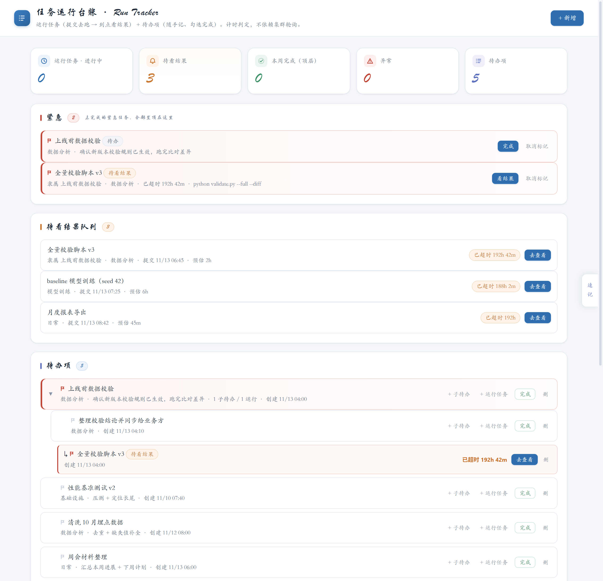
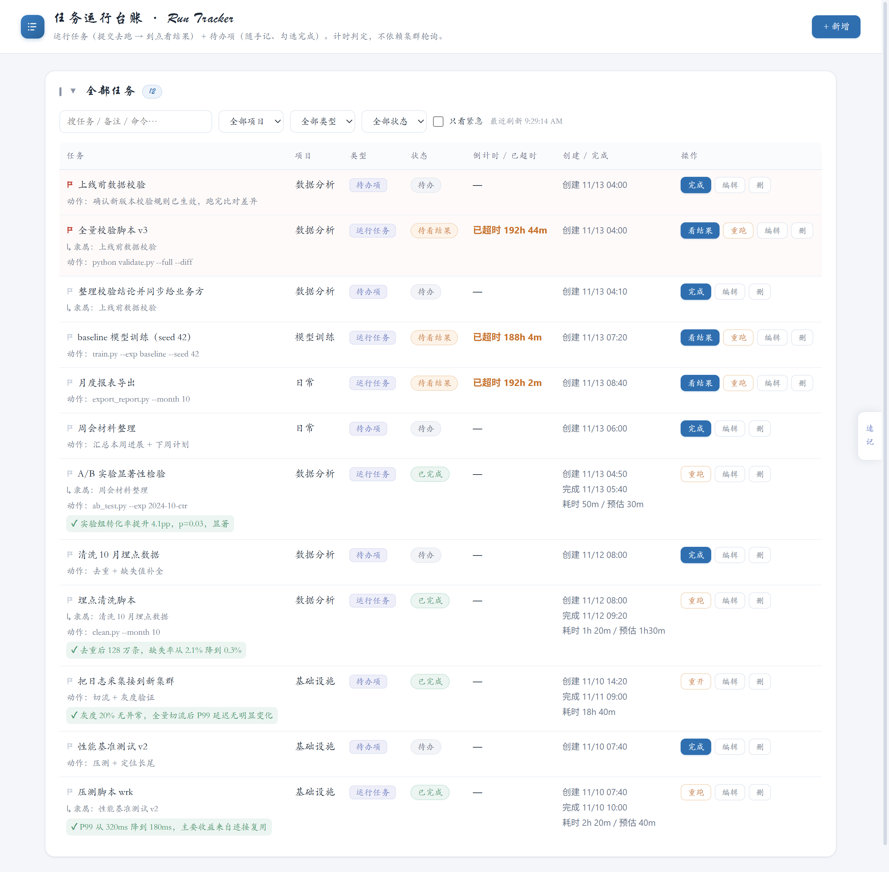
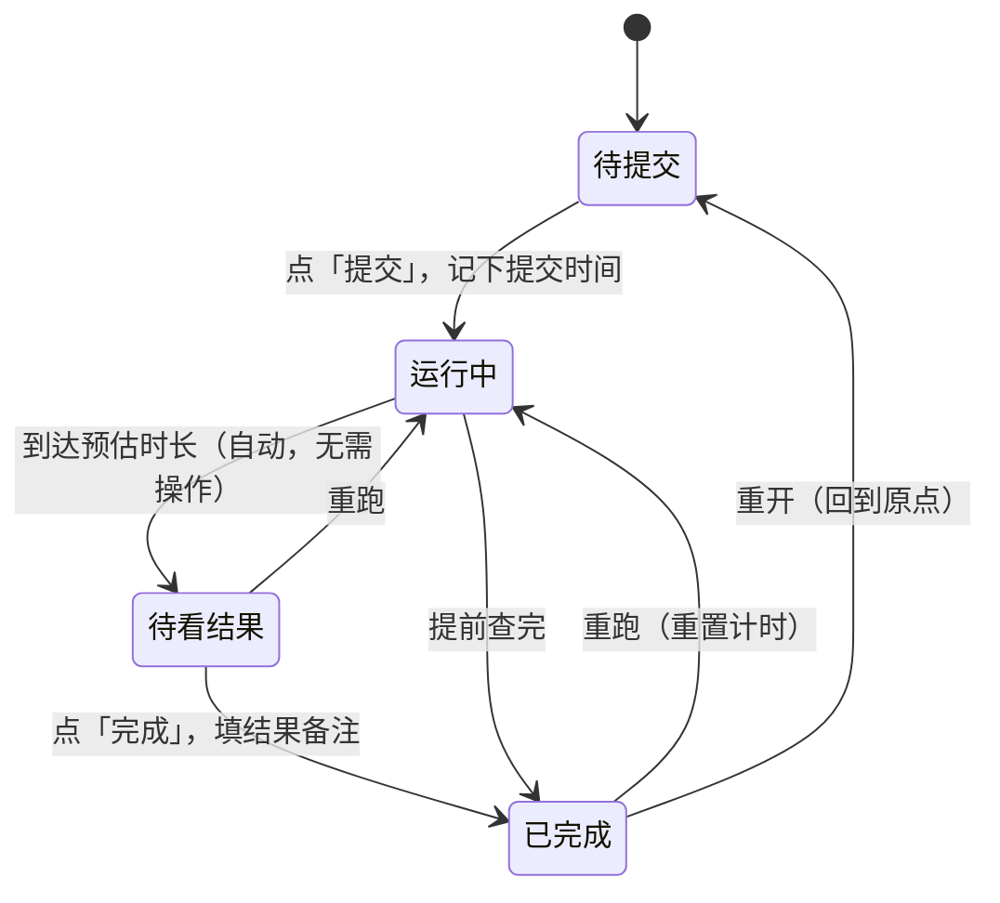

# RunLedger · 本地任务运行台账

> 记下任务 → 记录提交 → 预估等待时间 → 查看结果 → 留下结论。

RunLedger，取自 Run（运行）与 Ledger（台账）。[English quick start](README.en.md)


A zero-dependency local task board for "submit → wait → check result" workflows.
Timer-driven state machine, plain-JSON storage, no database, no cloud, fully offline.



## 它解决什么问题

「提交型任务」有个共同的尴尬：提交完要等，等完要回来查。而这件事很容易散在几个地方——

- 提交时想着「大概两小时」，两小时后正在做别的事，过了半天才想起来；
- 同时挂了七八个任务，哪个该去看结果、哪个还在跑，全靠脑子记；
- 终于看到结果了，结论记在便签、聊天记录、终端滚动buffer里，一周后找不到；
- 预估 30 分钟跑了 3 小时，事后没有任何数据能说明自己的预估偏了多少。

RunLedger 只做一件事：**把「提交 → 等 → 查 → 记结论」这条线变成了一个有状态、有计时、有历史的台账。**

适用的场景大致是：跑批量数据处理、训练模型、编译构建、压测、跑 CI、跑一次耗时较长的脚本——任何「提交之后要等一会儿才有结果」的活。

## 特点

| 特点 | 说明 |
|---|---|
| **零第三方依赖** | 只用 Python 标准库 `http.server`，不需要 `pip install` 任何东西 |
| **单文件数据** | 全部状态在一个 `runs.json` 里，人类可读，可直接用 git 管版本、复制即备份 |
| **完全离线** | 不联网、不依赖云服务、不采集任何数据 |
| **时间驱动** | 到点自动从「运行中」翻成「待看结果」，不需要轮询集群 |
| **树状组织** | 待办项下可挂子待办和运行任务，任意层级，可折叠 |
| **原子写盘** | 临时文件 + `os.replace`，进程中途被杀也不会写坏台账 |

## 快速开始

需要 Python 3.9 或更高版本，**不需要安装任何第三方库**。

```bash
git clone https://github.com/hustZhangYu/runledger.git
cd runledger
python app.py
```

浏览器打开 <http://127.0.0.1:7860> 即可。

### 想先看看长什么样

仓库里带了一份虚构演示数据。全新目录可复制后查看效果；已有 `runs.json` 时请先备份，避免覆盖个人记录：

```bash
cp runs.example.json runs.json          # Windows: copy runs.example.json runs.json
python app.py
```

### 换端口

7860 被占用时用环境变量指定：

```bash
RT_PORT=8080 python app.py              # Windows PowerShell: $env:RT_PORT=8080; python app.py
```

`RT_HOST` 同理，默认 `127.0.0.1`（只监听本机）。Windows 若 `python` 命令不可用，可以改用 `py -3`。

## 用法

1. **新增**：点右上角「+ 新增」。填任务名、归属项目、具体动作或提交命令、预估时长（`30m` / `2h` / `1h30m` 都可以）。
2. **提交**：真的把作业提交出去之后，在列表点「提交」。状态变成「运行中」，开始倒计时。
3. **等**：页面每 30 秒刷新一次倒计时；当 `现在 ≥ 提交时间 + 预估时长`，状态**自动**变成「待看结果」，并跳到首页高亮队列的最上面。
4. **看结果**：点「去查看」，填一句结论，标记「已完成」。这个结论会永久留在记录里。

页面通过高亮队列提示到期任务；它不会执行提交命令，也不会检测真实作业是否结束。关闭页面后需要运行 `reminder.py` 或配置系统定时任务才能看到提醒摘要，程序不内置桌面推送。

需要再跑一次就点「重跑」，重新开始计时。

## 界面



截图来自更新包中的虚构演示数据，拍摄时仍使用旧名称 Run Tracker；当前程序已统一为 RunLedger。

页面从上到下分六块：

- **紧急**：集中展示未完成的紧急任务，支持一键切换；没有紧急任务时自动隐藏。

- **统计卡**：运行中 / 待看结果 / 本周完成 / 异常 / 待办项。本周完成只统计**最顶层**的任务，避免父子任务被重复计数。
- **待看结果队列**：已到预估时间、还没去看的任务，按超时时长排序。这是你真正需要立刻处理的东西。
- **待办项**：树状展示，可折叠。父待办行会显示它挂了多少子待办和运行任务；只要有后代处于「待看结果」，整行会高亮——顺着颜色就能找到是哪条子任务卡住了。
- **全部任务**（可勾选「只看紧急」）：一张大表格，支持按关键词（任务名/备注/命令）、项目、类型、状态筛选。整块可折叠，默认收起。
- **已完成 · 按天回顾**：按完成日期分组，直接铺开每天做了什么、结论是什么。最近三天默认展开，更早的折叠。还带一个「日期未知」分组，收容早期没有完成时间的老记录。

待办树只展示尚未完成的后代，已完成项仍保留在「全部任务」和按天回顾中。

另外右侧贴着一栏**速记**，不占主流程的位置：

- 讨论完随手记一句，`Enter` 存下，`Shift+Enter` 换行。中文输入法选词时的回车不会被误当成保存。
- 按时间倒序排列，标「今天 / 昨天 / 月-日」，鼠标移到条目上出现「改」「删」。
- 空着的时候是个提示语，不会白占一块空白。
- 右上角 `⟩⟩` 收起整栏，右侧会留一个竖排「速记」书签，点它再展开。展开状态记在 `localStorage`，窄屏首次访问自动收起。
- 它和任务数据**分开存**（`notes.json`），速记不会混进任务统计、待办树和表格里。

### 字体

界面刻意用了手写体：大标题和统计数字是**行楷**，正文、任务名、表格文字是**楷书**；数字、时间、日期反而保持无衬线等宽（`tabular-nums`）——手写数字宽窄不一会把表格的列挤得参差，数据类的字规整一点更好读。

字体走系统栈，不引外部 webfont，断网也是这个样子：

| 位置 | 回退顺序 |
|---|---|
| 标题 | 霞鹜文楷 → 华文行楷 → 华文楷体 → 楷体 |
| 正文 | 霞鹜文楷 → 华文楷体 → 楷体 |
| 数字 / 时间 | 系统 UI 字体（Segoe UI / SF / Arial），`tabular-nums` 对齐 |

Windows 装了 Office 一般就有「华文行楷」「华文楷体」，macOS 自带「楷体-简」。两样都没有时会退回微软雅黑，版面不会乱，只是少了手写味。

不想要手写体，改 `static/index.html` 里 `:root` 的两个变量即可：`--f-hand`（正文）、`--f-title`（标题），替换成 `"Microsoft YaHei", sans-serif` 就回到常规观感，其余样式不用动。

## 紧急标记

任何任务（运行任务或待办项）都能打上紧急标记，三个入口：

- 点任务名左边的小旗子，点一下标上、再点取消。待办树、紧急区块、表格里都有这个旗子。
- 新增 / 编辑弹窗里勾「标为紧急」。
- 命令行录入时传 `"urgent": true`。

标记之后有四件事同时发生：进入顶部「紧急」区块、在待办树里红色高亮并排到同级最前、在表格里整行淡红底、执行提醒脚本时单独列一段。

任务完成后标记**不会被自动清除**，历史记录里还留着；但它不再出现在紧急区块——那块只列未完成的。这样既不会让已办的事继续占位置，也不会丢掉「这件事曾经很急」这个信息。

## 两种任务类型

| 类型 | 用途 | 有预估时长 | 状态流转 |
|---|---|---|---|
| **运行任务** | 提交去跑，需要到点看结果 | 必填 | 待提交 → 运行中 → 待看结果 → 已完成 |
| **待办项** | 随手记的事，做完打勾 | 不需要 | 待办 → 已完成 |

层级关系：待办项下可以挂**子待办**（把一件事拆成几步），也可以挂**运行任务**（某一步需要提交去跑）。典型用法是——

```
待办：上线前数据校验
├─ 运行任务：全量校验脚本 v3        ← 提交去跑，倒计时 2h
├─ 待办：整理校验结论并同步给业务方
└─ 待办：补回归用例
```

删除某个节点会**级联删除**它的所有后代，确认框会先告诉你将删除多少条。

## 状态机



「运行中 → 待看结果」这一跳完全由时间判定，每次读取数据时重新计算，不依赖定时器、也不需要服务一直开着。

## 数据模型

全部数据存在同目录的 `runs.json`，是一个对象数组。每条记录：

| 字段 | 类型 | 说明 |
|---|---|---|
| `id` | string | 自增短 id，形如 `r0007` |
| `type` | string | `运行任务` / `待办项` |
| `task` | string | 任务名（要办什么） |
| `project` | string | 归属项目，自由填写，不预设枚举 |
| `action` | string | 具体动作 / 提交命令 / 关注点 |
| `job_id` | string | 外部作业号，如集群任务号（选填） |
| `parent_id` | string | 上级待办项的 id，空表示顶层 |
| `est_label` | string | 预估时长的原始写法，如 `1h30m` |
| `est_minutes` | int | 预估时长，单位分钟 |
| `submit_time` | string | 提交时间（ISO 8601，带时区） |
| `done_at` | string | 完成时间 |
| `status` | string | 见上一节状态机 |
| `urgent` | bool | 是否紧急；旧数据缺少时按 false 处理 |
| `result_note` | string | 结果备注 / 结论 |
| `created_at` | string | 创建时间 |
| `updated_at` | string | 最后修改时间（**不要当完成时间用**，任何编辑都会刷新它） |

以下字段不落库，由后端在返回时派生，前端直接使用：

| 字段 | 说明 |
|---|---|
| `start_at` | 开始时间。**恒等于 `created_at`**，不需要手动点「开始」 |
| `elapsed_min` | 实际耗时 = `done_at` − `created_at` |
| `remaining_min` | 运行中任务的剩余分钟数 |
| `overdue_min` | 已超时的分钟数 |

## 速记的数据模型

速记单独存在同目录的 `notes.json`，结构比任务简单得多：

| 字段 | 类型 | 说明 |
|---|---|---|
| `id` | string | 自增短 id，形如 `n0007` |
| `text` | string | 内容，保留换行 |
| `created_at` | string | 记录时间（排序依据） |
| `updated_at` | string | 最后修改时间 |

## 设计取舍

这几个决定背后都有具体原因，写下来供参考，也方便你判断要不要改成别的样子。

**为什么用时间判定，不去查真实作业状态？**
不同集群、不同调度器的查询方式完全不同，接一个就要维护一个。而「我预估 2 小时」这个信息是提交时就有的，用它做倒计时不需要任何外部权限，零配置就能用。`job_id` 字段留着，真要接真实检测也不冲突。

**为什么用 JSON 文件，不上数据库？**
数据量就在几百到几千条的量级，SQLite 带来的收益抵不过「打开文件就能看、复制就能备份、`git diff` 能看历史」的便利。写入用临时文件 + `os.replace` 的原子替换，保证进程被杀时不会留下写坏一半的文件。

**为什么开始时间等于创建时间，不做「开始」按钮？**
这个工具是给自己用的。多一次点击换来的只是更精确的「开始时间」，但实际使用时没人会记得在开始做活时点一下——不准确的时间戳比没有更糟。所以干脆把它定义成创建时间，语义清晰、零操作。

**为什么项目名不写成固定下拉框？**
起初是硬编码的，后来发现每加一个项目就要改代码，于是改成从台账里动态汇总当前出现过的项目名；输入框配合 `<datalist>`，既有候选可点，也能直接敲一个新名字。

## 目录结构

```
runledger/
├── app.py                 # 后端：REST 接口 + 静态文件托管
├── helpers.py             # 共用逻辑：时长解析、状态重算、JSON 读写
├── static/
│   └── index.html         # 前端单页（HTML + CSS + 原生 JS，无构建步骤）
├── tests/
│   ├── smoke_test.py      # 冒烟测试：核心逻辑
│   └── api_test.py        # 接口回归：自动启动临时服务，隔离个人数据
├── reminder.py            # 提醒脚本：打印「待看结果」清单，可挂到定时任务
├── log_run.py             # 命令行录入：追加一条任务到台账
├── runs.json              # 你的数据（已被 .gitignore 排除）
├── notes.json             # 私人速记（已被 .gitignore 排除）
├── runs.example.json      # 演示数据
├── .github/workflows/     # GitHub Actions 配置
└── docs/                  # 截图
```

## 测试

不需要装 pytest，测试脚本只用标准库：

```bash
python tests/smoke_test.py     # 核心逻辑：时长解析、状态重算、派生字段、项目汇总
python tests/api_test.py       # 自动启动临时服务，不需要提前运行 app.py
```

速记的增删改和紧急状态切换也纳入回归检查。两套测试都在临时目录运行，不读写个人台账和速记数据。接口测试覆盖完整状态流转、树状删除、32 个并发创建请求、错误输入、损坏数据保护、静态文件目录边界和提醒分钟数。

GitHub Actions 配置为在 Windows / Linux、Python 3.9 / 3.13 上执行这些检查。本次整理已在本机 Windows 的 Python 3.9.13 和 3.13.5 上通过；云端结果以仓库 Actions 为准。

## 命令行与自动化

除了网页，还有两个小脚本，方便挂到系统的定时任务或脚本里。

**提醒**——打印当前该去看结果的任务，没有则打印一句 ✓ 并以 0 退出：

```bash
python reminder.py
```

可挂 cron（每小时打印一次摘要，结果可交给你自己的通知工具）：

```cron
0 * * * * cd /path/to/runledger && python reminder.py
```

**录入**——先停止 Web 服务，再在命令行追加记录；CLI 和 Web 不能同时写同一个台账：

```bash
echo '{"type":"运行任务","task":"跑一遍回归测试","project":"我的项目","est_label":"2h","action":"pytest -q"}' | python log_run.py
```

## API

后端就是几个 REST 接口，想接自己的前端或脚本可以直接用。

| 方法 | 路径 | 说明 |
|---|---|---|
| `GET` | `/api/runs` | 返回 `{runs: [...], projects: [...]}`，`runs` 已含派生字段 |
| `GET` | `/api/summary` | 统计：`counts`、`done_week`、`pending`、`todo_open`、`todo_count` |
| `POST` | `/api/runs` | 新建。`task` 必填；`type=运行任务` 时 `est_label` 必填 |
| `PUT` | `/api/runs/{id}` | 修改字段；`est_label` 传空串表示不修改 |
| `DELETE` | `/api/runs/{id}` | 删除，级联删除所有后代 |
| `POST` | `/api/runs/{id}/submit` | 提交，开始计时 |
| `POST` | `/api/runs/{id}/check` | 标记完成，body 可带 `result_note` |
| `POST` | `/api/runs/{id}/rerun` | 重跑，重置计时 |
| `POST` | `/api/runs/{id}/reopen` | 重开，回到初始状态 |
| `POST` | `/api/runs/{id}/urgent` | 紧急标记。body 可带 `{"urgent": true/false}`；不带 body 则一键翻转 |
| `GET` | `/api/notes` | 返回 `{notes: [...]}`，按创建时间倒序 |
| `POST` | `/api/notes` | 新建速记，body `{text}` |
| `PUT` | `/api/notes/{id}` | 修改速记内容，body `{text}` |
| `DELETE` | `/api/notes/{id}` | 删除一条速记 |

示例：

```bash
curl -X POST http://127.0.0.1:7860/api/runs \
  -H "Content-Type: application/json" \
  -d '{"type":"运行任务","task":"跑一遍回归测试","project":"我的项目","est_label":"2h"}'
```

## 已知限制

- 单机单用户，没有认证。默认只监听 `127.0.0.1`，**不要直接暴露到公网**。
- 任务和速记分别保存在 runs.json 与 notes.json 中。单个 Web 服务内的写请求由完整事务锁串行执行，并用原子替换保存；多个服务或 CLI 进程之间没有锁，不能同时写入。
- 损坏的 JSON 或错误的顶层数据结构会报错并保留原文件，请从备份恢复后重试。
- `ThreadingHTTPServer` 只是够用，不是生产级 Web 服务器。

## License

[MIT](LICENSE)
